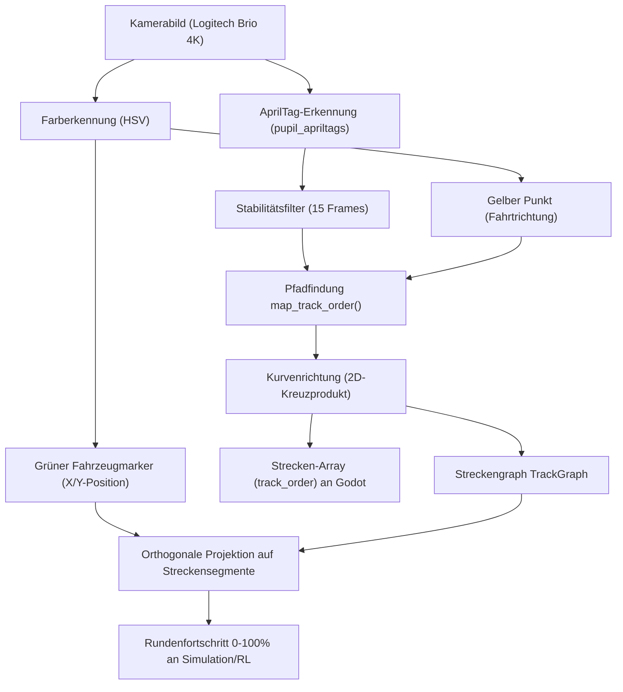

# Streckenerkennung – Carrera GO RL-Projekt

Kompakte Dokumentation und technischer Leitfaden zur kamerabasierten Streckenerkennung, Streckenrekonstruktion und Fortschrittsberechnung.

---

## 1. Überblick & Zweck

Die Streckenerkennung bildet das Bindeglied zwischen der physischen Carrera-Bahn und dem digitalen System (Godot-Simulator & Reinforcement-Learning-Agent). Sie erfüllt zwei Kernaufgaben:

1. **Statisches Streckenlayout (Systemstart):**  
   Erfasst die physischen Schienenteile über eine Deckenkamera und ermittelt die exakte Reihenfolge sowie Ausrichtung (Geraden, Links-/Rechtskurven). Diese Reihenfolge wird an den Godot-Simulator gesendet, welcher die 3D-Strecke zur Laufzeit modular aufbaut.
2. **Dynamischer Rundenfortschritt (Laufzeit):**  
   Aus den erkannten Schienenteilen wird ein 2D-Streckengraph (`TrackGraph`) konstruiert. Das getrackte Fahrzeug wird kontinuierlich auf diesen Graphen projiziert, um den Rundenfortschritt (0–100 %) in Echtzeit für den RL-Zustandsraum bereitzustellen.

---

## 2. Marker-Setup & Sensorik

### 2.1 AprilTags (`tag16h5`)
Auf den Schienen sind AprilTags der Familie `tag16h5` angebracht. Jeder Schienentyp besitzt eine feste ID:

| Tag-ID | Schienentyp / Name | Simulator Enum (`PARTS`) | Bemerkung |
| :---: | :--- | :--- | :--- |
| **1** | Start/Ziel | `FINISH` (1) | Fester Start- und Endpunkt der Pfadfindung |
| **2** | Kurze Gerade | `SHORT_STRAIGHT` (2) | Standard-Gerade kurz |
| **3** | Mittlere Gerade | `MEDIUM_STRAIGHT` (3) | Standard-Gerade mittel |
| **4** | Lange Gerade | `LONG_STRAIGHT` (4) | Standard-Gerade lang |
| **5** | Kurve | `RIGHT_CURVE` (5) / `LEFT_CURVE` (6) | Unterscheidung erfolgt rechnerisch via Kreuzprodukt |

* **Erkennungsstabilität:** Tags werden erst akzeptiert, wenn sie in mindestens 15 aufeinanderfolgenden Frames erkannt wurden (`STABLE_TAG_FRAMES = 15`), um Erkennungsflackern zu verhindern.

### 2.2 Farbmarker (HSV-Farbraum)
* **Gelber Orientierungspunkt (`YELLOW`):**  
  Befindet sich nahe der Start/Ziel-Schiene (ID 1). Der Vektor vom Start-Tag zum gelben Punkt definiert die initiale Fahrtrichtung des Kurses.
* **Grüner Fahrzeugmarker (`GREEN`):**  
  Grüne Markierung auf dem Fahrzeugdach zur Lokalisierung der aktuellen Fahrzeugposition via OpenCV-Momentenberechnung.

---

## 3. Algorithmen & Ablauf



### 3.1 Pfadfindung: Wie wird die Schienenreihenfolge ermittelt? (`map_track_order`)
1. **Startpunkt finden:** Das System sucht nach dem Start/Ziel-Tag (ID 1). Der Verbindungsvektor vom Start-Tag zum benachbarten gelben Referenzpunkt gibt die erste Vorwärtsrichtung vor.
2. **Rückwärtsfahren verbieten (Ausschlussfilter):** Von der aktuellen Schiene aus wird zurückgeblickt. Alle Schienen, die "hinter" der aktuellen Schiene liegen (Abweichung größer als 90° zur Vorwärtsrichtung), werden sofort aussortiert. Dadurch kann die Route niemals rückwärts laufen oder abkürzen.
3. **Nächste Schiene wählen:** Unter allen vor dem Auto liegenden Schienenteilen wird dasjenige gewählt, das die geringste Luftlinien-Distanz hat.
4. **Runde schließen:** Der Vorgang wiederholt sich Schiene für Schiene. Sobald der Sucher wieder bei Start/Ziel (ID 1) ankommt, ist der gesamte Rundkurs geschlossen und vollständig erfasst.

### 3.2 Kurvenrichtung: Wie erkennt das System Links- vs. Rechtskurven? (`determine_turn_direction`)
Da alle Kurventeile den identischen AprilTag (ID 5) besitzen, prüft das System den Krümmungsverlauf anhand von drei aufeinanderfolgenden Streckenstücken: der Schiene **vor** der Kurve, der Kurve **selbst** und der Schiene **nach** der Kurve.

* **Einfahrtsrichtung:** Richtung von der vorherigen Schiene zur Kurve.
* **Ausfahrtsrichtung:** Richtung von der Kurve zur nächsten Schiene.
* **Drehsinn (2D-Kreuzprodukt):** Das System multipliziert die Richtungsanteile über Kreuz:
  $$\text{Drehwert} = (\text{Einfahrt}_x \times \text{Ausfahrt}_y) - (\text{Einfahrt}_y \times \text{Ausfahrt}_x)$$
* **Ergebnis & Zuordnung:**
  * **Drehwert > +0,25:** Die Strecke knickt nach **rechts** ab $\rightarrow$ Rechtskurve (`RIGHT_CURVE`, Enum 5)
  * **Drehwert < -0,25:** Die Strecke knickt nach **links** ab $\rightarrow$ Linkskurve (`LEFT_CURVE`, Enum 6)
  * **Werte nahe 0 (zwischen -0,25 und +0,25):** Die Strecke verläuft im Wesentlichen geradeaus (Schwellwert filtert Rauschen).

### 3.3 Rundenfortschritt: Wie wird die Position des Autos bestimmt? (`TrackGraph`)
Die Rennstrecke wird als Kette gerader Abschnitte von Schienenmittelpunkt zu Schienenmittelpunkt gespeichert. Fährt das Auto über die Bahn, bestimmt das System die exakte Rundenposition in vier Schritten:

1. **Fahrzeugortung:** Die Kamera erkennt das grüne Autodach und liefert dessen X/Y-Bildkoordinaten.
2. **Lot fällen (Projektion):** Das System prüft alle Schienensegmente und fällt das mathematische Lot vom Auto auf die Strecke. Der Streckenabschnitt mit dem kürzesten Abstand ist der Bereich, auf dem sich das Auto gerade befindet.
3. **Teilstrecke ermitteln:** Auf diesem Streckenabschnitt wird berechnet, wie weit das Auto zwischen Schienenanfang (0 %) und Schienenende (100 %) fortgeschritten ist.
4. **Gesamtfortschritt berechnen:**
   $$\text{Rundenfortschritt (\%)} = \frac{\text{Streckenlänge bis zur aktuellen Schiene} + \text{Teilstrecke}}{\text{Gesamtlänge der Bahn}} \times 100$$

*Direkt an der Startlinie startet der Wert bei **0,0 %** und steigt kontinuierlich bis **100,0 %** bei Zieldurchfahrt. Dieser Prozentwert wird 5-mal pro Sekunde (5 Hz) an den Simulator gesendet, damit der RL-Agent immer weiß, wo auf der Strecke er sich befindet.*

---

## 4. Dateistruktur & Relevante Komponenten

| Pfad | Komponente | Hauptaufgabe |
| :--- | :--- | :--- |
| [`src/main.py`](file:///Users/abdulhamid/Documents/GitHub/carrera/src/main.py) | Hauptapplikation | Orchestrierung von Kamera, Tag-Detektor, Farbtracking, Aufruf von `map_track_order` und Senden an Godot. |
| [`src/config.py`](file:///Users/abdulhamid/Documents/GitHub/carrera/src/config.py) | Konfiguration | Tag-IDs (`TAG_MAP`), Schienentypen (`PARTS`), HSV-Farbgrenzen, Auflösung, Ports. |
| [`src/tracking/track_mapper.py`](file:///Users/abdulhamid/Documents/GitHub/carrera/src/tracking/track_mapper.py) | `TrackRecognizer` | Kern-Pfadfindung, Stabilitätsfilterung, Kurvenrichtungsberechnung. |
| [`src/tracking/track_graph.py`](file:///Users/abdulhamid/Documents/GitHub/carrera/src/tracking/track_graph.py) | `TrackGraph` | Segmentbasierter Graph, orthogonale Projektion zur Fortschrittsberechnung (0–100 %). |
| [`src/tracking/apriltag_detector.py`](file:///Users/abdulhamid/Documents/GitHub/carrera/src/tracking/apriltag_detector.py) | AprilTag-Wrapper | Kapselung der `pupil_apriltags`-Bibliothek für Detektion & Visualisierung. |
| [`src/camera/color_detector.py`](file:///Users/abdulhamid/Documents/GitHub/carrera/src/camera/color_detector.py) | `CarTracker` | HSV-Filterung für gelben Orientierungspunkt (`find_yellow_dot`) und grünes Auto (`find_car`). |
| [`src/camera/camera_manager.py`](file:///Users/abdulhamid/Documents/GitHub/carrera/src/camera/camera_manager.py) | Kamera-Backend | Initialisierung (DirectShow/Windows, AVFoundation/macOS, V4L2/Linux) mit minimaler Latenz (Puffer = 1 Frame). |
| [`src/network/network_client.py`](file:///Users/abdulhamid/Documents/GitHub/carrera/src/network/network_client.py) | TCP-Client | Sendet JSON-Nachrichten (`track_order`, `progress`) an den Godot-Simulator. |
| [`CarreraSimulator/Trackloader/remote_trackloader.gd`](file:///Users/abdulhamid/Documents/GitHub/carrera/CarreraSimulator/Trackloader/remote_trackloader.gd) | Godot TrackLoader | Empfängt `track_order` und feuert Signal `track_loaded`. |
| [`CarreraSimulator/Tracks/track_builder_2/TrackBuilder.gd`](file:///Users/abdulhamid/Documents/GitHub/carrera/CarreraSimulator/Tracks/track_builder_2/TrackBuilder.gd) | Godot TrackBuilder | Baut die modularen 3D-Schienenelemente (`straight.tscn`, `curve_left.tscn`, etc.) zur Gesamtstrecke zusammen. |

---

## 5. Netzwerkprotokoll (Python $\leftrightarrow$ Godot)

Die Kommunikation erfolgt über TCP-Sockets (Standard: `127.0.0.1:11360`):

* **Streckenlayout senden (Python $\to$ Godot):**
  ```json
  {"track_order": [1, 4, 5, 5, 6, 4, 6, 5, 5, 4, 2, 5, 4, 4, 4, 5]}
  ```
* **Fahrzeugfortschritt senden (Python $\to$ Godot):**
  ```json
  {"progress": 0.342}
  ```
* **Unfallmeldung senden (Python $\to$ Godot):**
  ```json
  {"crash_detected": true}
  ```

---

## 6. Wichtige Praxishinweise & bekannte Limitationen

1. **Hardcoded Fallback im Code:**
   In [`src/tracking/track_mapper.py`](file:///Users/abdulhamid/Documents/GitHub/carrera/src/tracking/track_mapper.py#L353) (Zeile 353) ist die `track_order` für Testzwecke fest verdrahtet (`track_order_numbers = [1, 4, 5, ...]`). Für eine vollautomatische Übertragung des dynamisch erkannten Kurses muss diese Zeile auskommentiert werden.
2. **Beleuchtungsempfindlichkeit:**
   Extreme Helligkeit oder Schattenwurf erschweren die AprilTag-Erkennung. Diffuses Licht (z. B. über eine Softbox) wird dringend empfohlen. Reflexionen auf glatten Schienen können die Erkennung stören.
3. **Fehldetektionen auf Holzböden:**
   Starke Maserungen in Holzoberflächen wurden in Tests vereinzelt fälschlicherweise als `tag16h5` interpretiert. Ein Wechsel zur AprilTag-Familie `tag36h11` bietet stärkere Fehlerkorrektur.
4. **Kamerapositionierung:**
   Die Kamera muss alle Streckenteile im Bildfeld (FOV) haben. Eine leichte Neigung oder variierender Abstand wird durch die Projektion im Streckengraphen toleriert.
