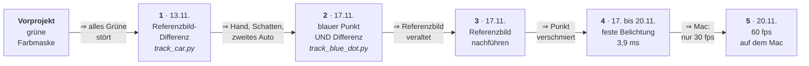
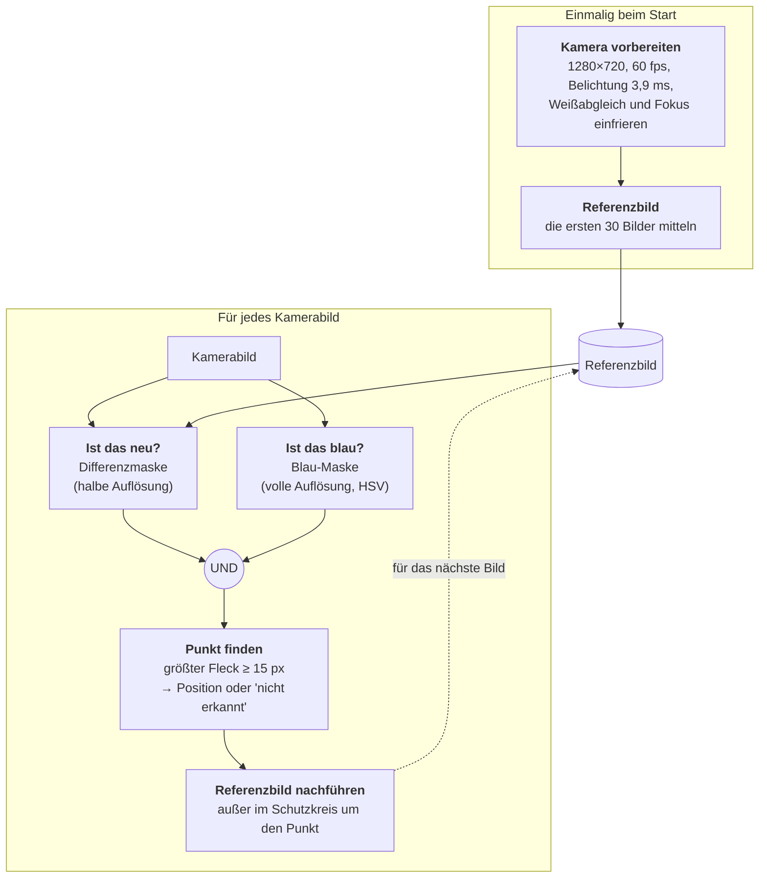
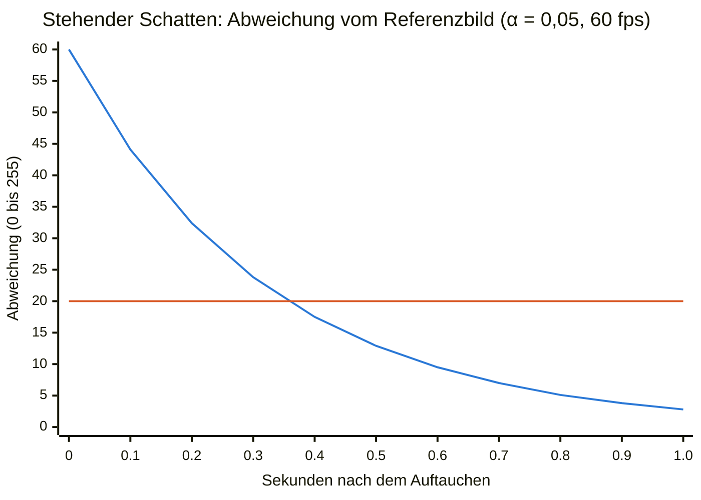

# Car Tracking: Wie wir das Auto im Kamerabild finden

> Draft, Stand 20.11.2026. Beschreibt `track_blue_dot.py` auf dem Branch `car_tracking`.
> Bedienung und Installation stehen in der [README](README.md), hier geht es um das Warum.

Das Tracking liefert für jedes Kamerabild die Pixelposition `(x, y)` unseres Autos oder ausdrücklich
„nicht erkannt“. Dazu klebt ein blauer Punkt auf dem Auto, und wir suchen im Bild die Stelle, die neu
(anders als die leere Strecke) und blau ist.

## Der Weg zur Lösung



Das Vorprojekt hat die größte grüne Fläche im Bild als Auto genommen. Jedes andere grüne Ding
konkurrierte damit, und wenn nichts gefunden wurde, ging `(0, 0)` als Position weiter.

1. Wir haben das Kamerabild mit einem Foto der leeren Strecke verglichen. Was sich verändert hat, ist
   das Auto, genauer gesagt die größte Veränderung. Eine Markierung braucht man dafür nicht.
   ⇒ Eine Hand oder ein Schatten ist größer als das Auto, und beim OpenCampus fährt immer auch das Auto
   des Besuchers mit.
2. Auf das Auto kam ein blauer Punkt. Seitdem zählt nur, was neu und blau ist. ⇒ Das Referenzbild
   stammte noch vom Start. Ändert sich das Licht, ist bald alles „neu“, und der Filter wirkt nicht mehr.
3. Das Referenzbild wird laufend nachgeführt, nur nicht am Auto. Die Idee entstand parallel in
   `track_car_dyn_bg.py`. Seitdem entsteht auch das erste Referenzbild automatisch, und die Taste `b`
   ist weggefallen. ⇒ Bei voller Fahrt verschmiert der Punkt und fällt aus dem Farbbereich.
4. Die Belichtung ist jetzt kurz und fest eingestellt. Farbbereich und Schwellwert haben wir an das
   dunklere Bild angepasst. ⇒ OpenCV liefert auf dem Mac nur 30 fps und kann die Kamera nicht sperren.
5. Auf dem Mac holen wir die Bilder über PyAV und stellen die Kamera mit uvc-util ein. Am Tracking
   selbst ändert das nichts.

---

## So funktioniert das Tracking




| Kamerabild mit erkanntem Punkt | Differenzmaske (Ansicht 1) | Blau-Maske (Ansicht 2) |
|---|---|---|
|  |  |  |

### Kamera vorbereiten

Webcams regeln Helligkeit, Farbe und Schärfe ständig nach. Für uns ist das schädlich. Fährt ein dunkles
Auto ins Bild, hellt die Kamera das ganze Bild etwas auf, und plötzlich weicht jedes Pixel vom
Referenzbild ab. Deshalb lassen wir Weißabgleich und Fokus kurz einschwingen und frieren sie dann ein.

Die Belichtungszeit stellen wir fest und kurz ein. Solange die Kamera belichtet, fährt das Auto weiter.
Bei langer Belichtung verschmiert der blaue Punkt zu einem blassen Streifen (Motion Blur), fällt aus dem
Farbbereich und wird nicht mehr zuverlässig erkannt. Eine kurze Belichtung macht das Bild allerdings
dunkler. Farbbereich und Schwellwert sind deshalb auf genau diese Belichtung abgestimmt. Wer sie
ändert, muss beides neu einstellen.

Auch die Bildrate zählt: Je mehr Bilder pro Sekunde, desto kürzer ist das Stück, das das Auto zwischen
zwei Messungen fährt.

| Lange Belichtung | Kurze Belichtung |
|---|---|
|  |  |

*Ausschnitt um den Punkt bei voller Fahrt.*

### Referenzbild aufnehmen

Direkt nach dem Start werden die ersten 30 Bilder gemittelt. Die Kamera liefert nie zweimal exakt
dieselben Werte (Sensorrauschen). Im Mittelwert hebt sich das Rauschen weitgehend auf, und das
Referenzbild wird ruhig.

Die Strecke muss dafür nicht leer sein. Was beim Start im Bild ist, zum Beispiel eine Hand, rechnet das
Nachführen (siehe unten) nach Sekundenbruchteilen wieder heraus. Einen Haken gibt es: Steht das Auto
beim Start schon auf der Strecke, gehört es zum Referenzbild und gilt nicht als „neu“. Es wird erst
erkannt, sobald es losfährt. Danach bleibt es auch im Stand erkannt, weil der Schutzkreis es schützt.


### Ist das neu? Die Differenzmaske

Das Prinzip heißt in der Bildverarbeitung *Background Subtraction*: Was sich gegenüber dem Referenzbild
verändert hat, ist neu.


1. Das Kamerabild wird auf halbe Breite und Höhe verkleinert. Dann bleibt ein Viertel der Pixel, das
   spart Rechenzeit, und für einen Fleck von der Größe eines Autos reicht die Auflösung trotzdem.
   Danach wird es leicht weichgezeichnet, damit Rauschen und JPEG-Artefakte nicht als Veränderung
   zählen. Das Referenzbild liegt schon in derselben Form vor.
2. Für Blau, Grün und Rot wird getrennt gemessen, wie stark jedes Pixel vom Referenzbild abweicht. Es
   zählt die größte der drei Abweichungen. So fällt auch etwas auf, das genauso hell ist wie die
   Fahrbahn, aber eine andere Farbe hat.
3. Ein Schwellwert teilt jedes Pixel in neu (weiß) oder unverändert (schwarz) ein. Ist er zu niedrig,
   wird Rauschen weiß. Ist er zu hoch, fehlen dunkle Teile des Autos. Wir nutzen 20 statt anfangs 30:
   Durch die kurze Belichtung ist das Bild dunkler, und damit werden auch die Abweichungen kleiner.
4. Opening entfernt einzelne weiße Rauschpunkte, Closing schließt Löcher in Flächen, zum Beispiel an
   den Fenstern des Autos.
   ([Visualisierung bei OpenCV](https://docs.opencv.org/4.x/d9/d61/tutorial_py_morphological_ops.html))
5. Zum Schluss wird die Maske wieder auf volle Auflösung hochskaliert, damit sie zur Blau-Maske passt.

### Ist das blau? Die Blau-Maske

Wir rechnen das Bild in den HSV-Farbraum um und markieren alle Pixel, die in einem festen Farbbereich
liegen.

Im RGB-Farbraum steckt die Helligkeit in allen drei Kanälen. Wird der Punkt etwas dunkler, ändern sich
R, G und B gleichzeitig, und ein fester Bereich für „blau“ lässt sich schwer angeben. HSV trennt Farbe
und Helligkeit:

| Kanal | Bedeutung | Bereich für unseren Punkt |
|---|---|---|
| H (Hue, Farbton) | welche Farbe, als Winkel auf dem Farbkreis | 104 bis 118 |
| S (Saturation, Sättigung) | wie kräftig die Farbe ist, 0 = grau | ab 110 |
| V (Value, Helligkeit) | wie hell | ab 40 |

OpenCV halbiert den Farbton, damit er in ein Byte passt (0 bis 179 statt 0 bis 359°). 104 bis 118
entspricht also etwa 208 bis 236°, das ist reines Blau. Fällt ein Schatten auf den Punkt, ändert sich
vor allem V, der Farbton bleibt gleich.

Die Blau-Maske wird in voller Auflösung berechnet, weil der Punkt nur wenige Pixel groß ist. Auf halber
Auflösung bliebe kaum etwas von ihm übrig.

Die Grenzen haben wir am echten Kamerabild gemessen: Ein Klick ins Fenster gibt den HSV-Wert an dieser
Stelle im Terminal aus, eingetragen werden die Grenzen von Hand. Den ersten, hellblauen Punkt (Sättigung um 113) haben wir dabei gegen einen kräftigeren
getauscht (Sättigung 240 bis 255), der sich deutlicher von der Umgebung abhebt.

### Punkt finden

Die beiden Masken werden mit UND verknüpft. Übrig bleibt nur, was neu und gleichzeitig blau ist:

|  | blau | nicht blau |
|---|---|---|
| neu | erkannt: der Punkt auf unserem Auto | ignoriert: Hand, Schatten, Auto des Besuchers |
| schon im Referenzbild | ignoriert: blaue Dinge neben der Strecke | ignoriert: Strecke, Tisch, Boden |

| Hand im Bild: Differenzmaske | gleiche Szene: Blau-Maske |
|---|---|
|  |  |

*Die Hand ist neu, aber nicht blau, und wird ignoriert.*

Im Ergebnis werden zusammenhängende Flecken gesucht. Der größte zählt, wenn er mindestens 15 px hat,
kleinere sind Rauschen. Die Position ist der Schwerpunkt des Flecks, also der Mittelwert der x- und
y-Koordinaten all seiner Pixel. Gibt es keinen passenden Fleck, ist das Ergebnis `None` („nicht
erkannt“). Im Vorprojekt wurde in diesem Fall `(0, 0)` weitergegeben.


*Roter Ring: erkannter Punkt, Mittelpunkt als einzelnes Pixel.*

### Referenzbild nachführen

Damit das Referenzbild nicht veraltet, wird jedes seiner Pixel pro Frame zu 95 % aus dem alten Wert und
zu 5 % aus dem aktuellen Bild gebildet:

```
Referenz_neu = 0,95 · Referenz_alt + 0,05 · aktuelles Bild        (α = 0,05)
```

Das ist ein exponentiell gleitender Mittelwert. Eine Veränderung, die liegen bleibt, wird pro Frame um
5 % „vergessen“. Nach *n* Frames ist noch 0,95ⁿ von ihr übrig, nach 13,5 Frames also die Hälfte. Bei
60 fps entspricht das einer Halbwertszeit von etwa 0,2 s.

Ein Beispiel: Ein Schatten fällt auf die Strecke und bleibt dort. Er weicht zuerst um 60 vom
Referenzbild ab. Nach ungefähr 21 Frames (0,36 s) liegt die Abweichung unter dem Schwellwert von 20, und
der Schatten ist aus der Differenzmaske verschwunden.


*Blaue, fallende Kurve: Abweichung des Schattens. Orange, waagrechte Linie: Schwellwert 20. Ab dem Schnittpunkt zählt
der Schatten nicht mehr als „neu“.*

Am Auto selbst darf das Referenzbild nicht nachgeführt werden. Sonst wäre ein stehendes Auto nach einer
halben Sekunde Teil des Hintergrunds und nicht mehr zu finden. Deshalb bleibt ein Kreis mit 70 px Radius
um die letzte Position des blauen Punkts unverändert, der Schutzkreis.

- Der Kreis liegt um den blauen Punkt und nicht um die größte Veränderung. Sonst würde zum Beispiel eine
  Hand geschützt statt unseres Autos.
- Geht der Punkt kurz verloren, bleibt der Kreis an der letzten bekannten Position.

Das Referenzbild wird intern mit Kommazahlen gespeichert. Bei Ganzzahlen würden 5 % einer kleinen
Abweichung (5 % von 8 sind 0,4) jedes Mal auf 0 abgerundet, und das Referenzbild würde sich nie bewegen.

| Gegenstand gerade abgelegt | ca. 1 s später | Auto steht still |
|---|---|---|
|  |  |  |

*Differenzmaske. Rechts: Das stehende Auto bleibt dank Schutzkreis sichtbar.*

### Stellschrauben

| Parameter | Standard | Wirkung |
|---|---|---|
| Schwellwert (`+`/`-`) | 20 | ab welcher Abweichung ein Pixel als „neu“ gilt |
| Blau-Bereich (HSV) | H 104 bis 118, S ≥ 110, V ≥ 40 | was als „blau“ gilt. Werte per Klick auslesen, Grenzen im Code anpassen |
| Mindestgröße Punkt | 15 px | kleinere blaue Flecken gelten als Rauschen |
| Belichtung | 3,9 ms | kürzer heißt weniger Unschärfe, aber ein dunkleres Bild |
| Anpassungsrate α | 0,05 | wie schnell das Referenzbild nachzieht. Bei 0 aus, dann muss die Strecke beim Start leer sein |
| Schutzkreis | 70 px | muss das ganze Auto abdecken |
| Verkleinerung | 50 % | nur für die Differenzmaske |
| Bilder fürs Referenzbild | 30 | |


## Grenzen und offene Punkte

- Das Tracking liefert Pixel, keine Streckenposition. Wie weit das Auto auf der Strecke ist, ergibt sich
  erst zusammen mit der Streckenerkennung.
- Ein Punkt steht für ein Auto. Das Auto des Besuchers wird absichtlich ignoriert. Soll es auch
  getrackt werden, braucht es einen Punkt in einer anderen Farbe.
- Der Blau-Bereich hängt an Licht und Belichtung und passt sich nicht automatisch an. In einem anderen
  Raum, etwa beim OpenCampus, muss er neu bestimmt werden: Per Klick auf den Punkt die HSV-Werte
  auslesen und die Grenzen dann von Hand im Code anpassen (`BLUE_LOW`, `BLUE_HIGH`).
- Ein stehendes Auto, dessen Punkt nicht erkannt wird (z. B. nach einem Abflug umgekippt und außerhalb
  des Schutzkreises), ist nach weniger als einer Sekunde Teil des Referenzbilds. Sobald es wieder
  fährt, wird es wieder erkannt.