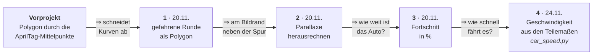
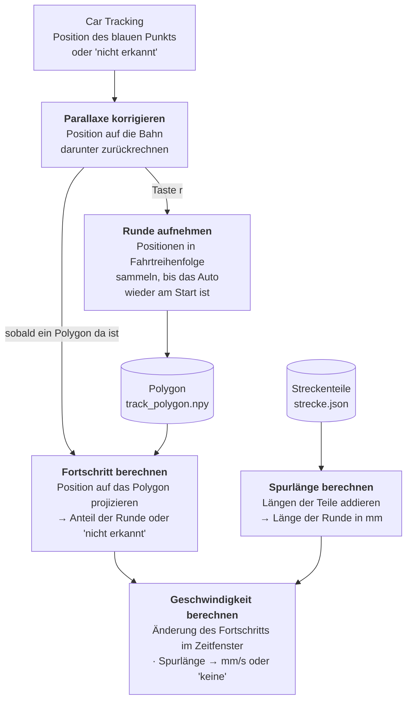
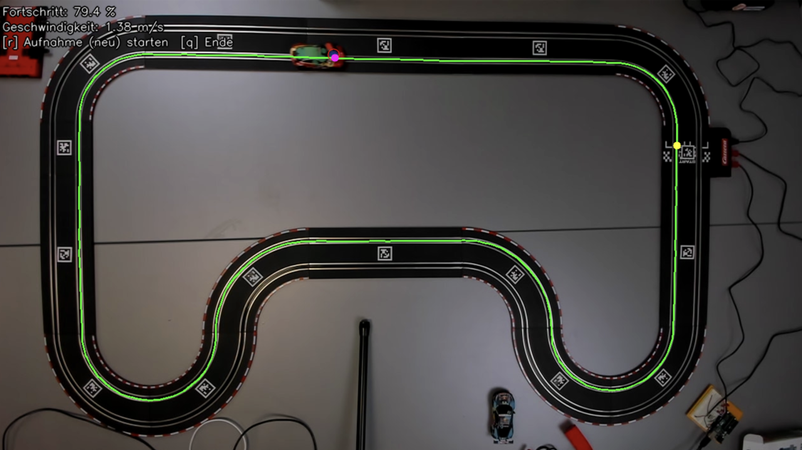
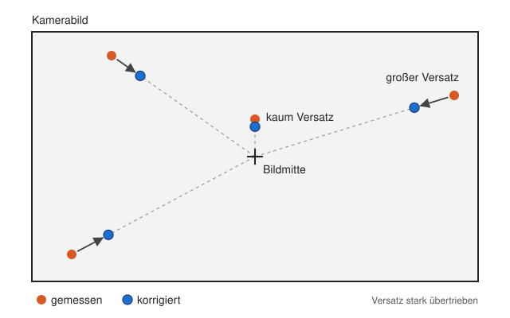
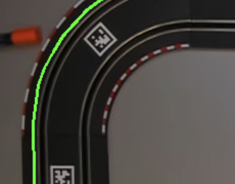
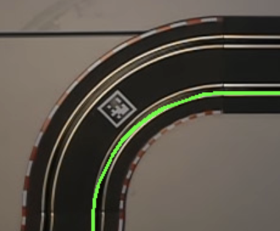
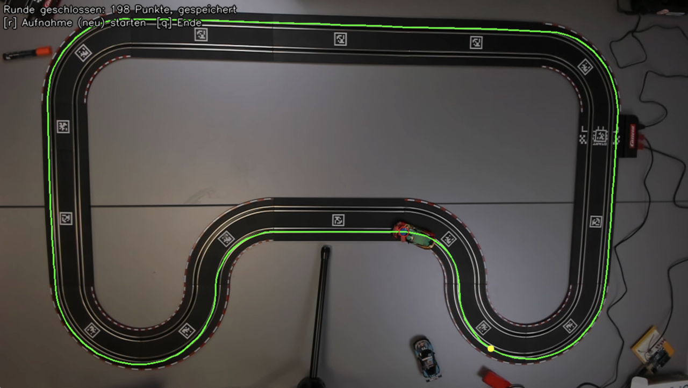
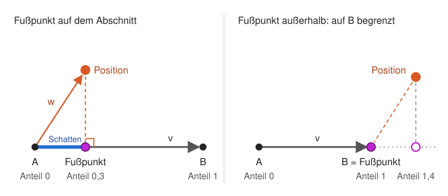
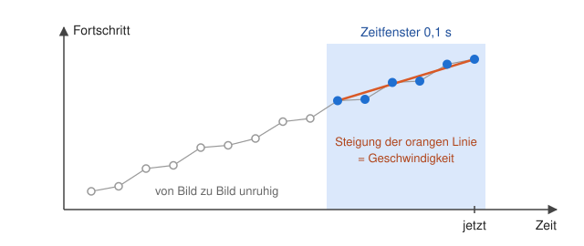

# Car to Track: Strecke, Fortschritt und Geschwindigkeit aus der Fahrt des Autos

> Draft, Stand 24.11.2026. Beschreibt `car_to_track.py` und `car_speed.py` auf dem Branch `car_to_track`.
> Die Bedienung steht in den Docstrings der Dateien, hier geht es um das Warum. Die Position des Autos
> kommt aus dem Car Tracking, siehe [dessen Doku](../car_diff_tracking/DOKU.md).


## Der Weg zur Lösung



Das Vorprojekt hat den Fortschritt auf einem Polygon durch die Mittelpunkte der AprilTags berechnet.
Die Verbindungslinien zwischen den Tags schneiden jede Kurve ab, mit der gefahrenen Linie hatte das
Polygon wenig zu tun. Die Geschwindigkeit kam aus Godot. Dort fuhr ein simuliertes Auto nach dem
Throttle weiter und wurde nur 5-mal pro Sekunde auf den gemessenen Fortschritt gesetzt, die
Geschwindigkeit war also größtenteils simuliert und nicht gemessen.

1. Wir nehmen eine Runde lang die Positionen des blauen Punkts auf. Weil das Auto der Spur folgt, liegen
   sie schon in Fahrtrichtung vor und bilden direkt das Polygon. ⇒ Zum Bildrand hin lag das Polygon
   sichtbar außen neben der Spur, und zwar umso mehr, je weiter vom Bildmittelpunkt entfernt.
2. Die Ursache ist die Parallaxe, der Punkt liegt höher als die Bahn. Jede Position wird jetzt auf die
   Stelle der Bahn direkt darunter zurückgerechnet. ⇒ Das Polygon allein sagt noch nicht, wie weit das
   Auto auf der Runde ist.
3. Die aktuelle Position wird auf das Polygon projiziert. Daraus ergibt sich der Fortschritt in Prozent.
   ⇒ Für eine Geschwindigkeit fehlt ein echter Maßstab. Wie viele Millimeter ein Pixel ist, hängt
   davon ab, wie hoch die Kamera hängt.
4. Die Länge der Spur in Millimetern berechnen wir aus den Streckenteilen, die in einer Config stehen.
   Mit ihr wird aus der Änderung des Fortschritts eine Geschwindigkeit in Millimetern pro Sekunde.

---

## So funktioniert es




*Grün: Polygon. Gelb: Startpunkt. Magenta: Position des Autos auf dem Polygon. Oben links Fortschritt
und Geschwindigkeit.*

### Parallaxe korrigieren

Der blaue Punkt klebt 2 cm über der Bahn auf dem Auto. Die Kamera sieht ihn entlang einer schrägen
Sichtlinie, und diese Linie trifft die Bahn erst ein Stück weiter außen. Im Bild erscheint der Punkt
deshalb dort, wo diese äußere Stelle der Bahn liegt. Direkt unter der Kamera, also in der Bildmitte,
fällt das nicht auf. Zum Rand hin wächst der Versatz, und er zeigt immer von der Bildmitte weg.


*Seitenansicht, nicht maßstabsgetreu. Die Höhe h ist stark übertrieben.*

Wie groß der Versatz ist, folgt aus dem Strahlensatz. Die Sichtlinie geht von der Kamera in Höhe H durch
den Punkt in Höhe h. Bis zum Punkt sinkt sie um H - h und kommt dabei waagrecht X weit. Bis zur Bahn
muss sie um H sinken und kommt dabei X · H / (H - h) weit. Der Punkt erscheint also um den Faktor
H / (H - h) zu weit von der Bildmitte entfernt.

Weil die Kamera senkrecht nach unten schaut, ist der Abstand zur Bildmitte im Bild proportional zum
Abstand auf der Bahn. Zum Korrigieren wird jede Position um den umgekehrten Faktor zur Bildmitte
gezogen:

```
korrigiert = Bildmitte + (gemessen - Bildmitte) · (H - h) / H
```


*Kamerabild von oben, Versatz stark übertrieben. Jeder Punkt rutscht auf der Linie zur Bildmitte nach
innen, immer um denselben Anteil seines Abstands. Punkte am Rand wandern deshalb weit, Punkte nahe der
Mitte kaum. Farben wie in der Seitenansicht: orange, wo die Kamera den Punkt sieht, blau die Bahn
darunter.*

Bei unserem Aufbau ist der Faktor 106 / 108 ≈ 0,98. Das klingt nach wenig, am Bildrand sind es aber bis
zu 12 px.

Für Fortschritt und Geschwindigkeit allein wäre die Korrektur nicht nötig, denn die Live-Position hat
denselben Versatz wie das Polygon. Sobald wir das Polygon mit der echten Strecke vergleichen, etwa mit den AprilTags oder
den Teilemaßen in Millimetern, zählt aber jeder systematische Fehler.

Die Rechnung nimmt an, dass die Kamera genau senkrecht nach unten schaut und die Bildmitte die Stelle
direkt unter ihr ist. Liegt das korrigierte Polygon auf einer Seite der Strecke noch daneben, hängt die
Kamera leicht schräg.

| Äußere Kurve am Bildrand | Innere Kurve nahe der Bildmitte |
|---|---|
|  |  |

*Polygon vor der Korrektur. Links liegt es außen neben der Spur, das ist die Parallaxe. Rechts schneidet
es die Kurve nach innen. Das hat eine andere Ursache: Der Punkt klebte damals hinter dem Leitkiel, und
der Rest des Autos fährt wie der Anhänger eines LKW einen engeren Bogen als der Kiel. Seit der Punkt über
dem Kiel sitzt, folgt das Polygon auch in den Kurven der Spur.*

### Runde aufnehmen

Die Positionen kommen in der Reihenfolge, in der das Auto die Strecke abfährt. Eine Runde lang
gesammelt, sind sie schon das fertige Polygon. Sortieren muss man nichts.

Ein neuer Punkt kommt erst dazu, wenn er mindestens 5 px vom letzten entfernt ist. Steht das Auto,
entsteht so kein Punkthaufen, und langsame Stellen bekommen nicht mehr Punkte als schnelle. Bilder, in
denen der Punkt nicht erkannt wird, fallen weg. Das Polygon verbindet die Nachbarn dann mit einer
geraden Linie. So ist in der ersten Runde die Kante bei Punkt 188 entstanden.

Die Runde ist geschlossen, sobald das Auto wieder weniger als 30 px vom Startpunkt entfernt ist.
Außerdem müssen mindestens 100 Punkte da sein. Sonst wäre die Runde gleich nach dem Start schon
geschlossen, weil das Auto dann noch neben dem Startpunkt fährt.

Gespeichert wird ein NumPy-Array mit N Zeilen und 2 Spalten. Jede Zeile ist ein Punkt, die Zeilen
liegen in Fahrtrichtung, die Spalten sind x und y in Pixeln. Beim nächsten Start wird die Datei automatisch
geladen. Die Pixel gelten nur für genau diesen Kameraaufbau, deshalb ist die Datei nicht im Git.

Die Runde sollte langsam und gleichmäßig gefahren werden. Bei voller Fahrt verschmiert der Punkt
leichter, und das Heck schwenkt in den Kurven aus. Beides macht das Polygon ungenauer.

| Reihenfolge der Punkte | Polygon im Kamerabild |
|---|---|
|  |  |

*Links die erste Runde mit Punktnummern. Die gerade Kante bei 188 ist ein Aussetzer. Rechts eine
spätere Runde, noch ohne Parallaxe-Korrektur.*

### Fortschritt berechnen

Die Idee stammt aus dem Wiki ([Überarbeitung Streckenerkennung](https://app.notion.com/p/417946076ebb8085a4f0c081f6cc3afa)):
Die Position des Autos ist der Anteil der Runde, den es seit dem Startpunkt zurückgelegt hat.

Die Live-Position liegt fast nie genau auf dem Polygon. Ein kleiner seitlicher Abstand bleibt immer,
schon weil keine Runde genau wie die andere gefahren wird. Deshalb wird die Position auf das Polygon
projiziert:


Gespeichert sind nur die Punkte. Die Abschnitte entstehen erst beim Rechnen, denn zwei benachbarte
Punkte legen einen Abschnitt schon fest. Der letzte Abschnitt führt zurück zum Startpunkt und schließt
die Runde. Ohne ihn hätte das Stück zwischen dem letzten aufgenommenen Punkt und dem Start keinen
Abschnitt, und die Rundenlänge wäre zu kurz.

| Abschnitt | Anfang A | Ende B |
|---|---|---|
| 0 | P0 | P1 |
| 1 | P1 | P2 |
| … | … | … |
| N-1 | P(N-1) | P0 |

Auf jeden Abschnitt wird das Lot von der Position gefällt. Der Fußpunkt ist die Stelle, an der die
Verbindung senkrecht auf den Abschnitt trifft. Seine Lage beschreibt der Anteil des Abschnitts von A
bis zum Fußpunkt (im Code `fraction_along_segment`): 0 heißt bei A, 1 bei B.


*Orange gestrichelt: der Abstand, mit dem dieser Abschnitt in den Vergleich geht.*

Berechnet wird der Anteil mit dem Skalarprodukt. Sei v der Vektor von A nach B, w der Vektor von A zur
Position und θ der Winkel zwischen beiden. Dann ist w · v = |w| · |v| · cos θ, und |w| · cos θ ist genau
der Schatten von w auf dem Abschnitt (blau). Geteilt durch die Länge des Abschnitts ergibt sich

```
Anteil = Schatten / |v| = (w · v) / |v|²
```

Läge der Fußpunkt auf der Verlängerung des Abschnitts (rechts im Bild), wäre der Anteil kleiner als 0
oder größer als 1. Dann wird er auf 0 bzw. 1 begrenzt, und der Fußpunkt ist A bzw. B. Ohne diese Grenze würde
jeder Abschnitt wie eine unendlich lange Gerade behandelt. Ein weit entfernter Abschnitt könnte dann
gewinnen, nur weil seine Verlängerung nah an der Position vorbeiläuft.

Das Programm rechnet Anteil, Fußpunkt und Abstand für alle Abschnitte gleichzeitig und wählt erst danach den
mit dem kürzesten Abstand. Ein Beispiel mit drei Abschnitten aus einem längeren Polygon, den Punkten
P0 (0, 0), P1 (10, 0), P2 (20, 0), P3 (20, 10) und der Position (14, 3):

| Abschnitt | Anteil | Anteil begrenzt | Fußpunkt | Abstand |
|---|---|---|---|---|
| P0 → P1 | 1,4 | 1 | (10, 0) | 5 |
| P1 → P2 | 0,4 | 0,4 | (14, 0) | 3 |
| P2 → P3 | 0,3 | 0,3 | (20, 3) | 6 |

Der mittlere Abschnitt gewinnt. Dass der Anteil bei P2 → P3 zwischen 0 und 1 liegt, reicht also
nicht, es entscheidet der Abstand.

Der zurückgelegte Weg vom Startpunkt bis zum Fußpunkt (`distance_travelled`) ist die Länge aller
Abschnitte vor dem Gewinner plus der Anteil des Gewinners an dessen Länge. Liegt der Startpunkt bei P0,
sind das 10 + 0,4 · 10 = 14 px. Geteilt durch die Länge der ganzen Runde (`lap_length`) ergibt das den
Fortschritt. Weil dabei Längen addiert und keine Punkte gezählt
werden, ist ein Prozent immer gleich viel Weg, auch wenn die Punkte unterschiedlich dicht liegen.

Wird der Punkt nicht erkannt, ist der Fortschritt „nicht erkannt“ und nicht der letzte bekannte Wert.

### Spurlänge berechnen

Der Fortschritt ist ein Anteil der Runde und hat keine Einheit. Für eine Geschwindigkeit in Millimetern
pro Sekunde braucht es die Länge der Runde in Millimetern. Aus dem Polygon lässt sie sich nicht ablesen,
denn es kennt nur Pixel. Die echte Strecke ist aber aus Teilen mit bekannten Maßen gebaut (siehe Wiki,
[Überarbeitung Streckenerkennung](https://app.notion.com/p/417946076ebb8085a4f0c081f6cc3afa)), ihre
Länge ist die Summe dieser Teile.

Bis die Streckenerkennung die Teile über die AprilTags liefert, tragen wir sie von Hand in eine Config
ein (`strecke.json`):

```json
{
  "spur": "rechts",
  "teile": ["start", "lang", "R", "R", "L", "lang", ...]
}
```

Unter `teile` stehen die Streckenteile in Fahrtrichtung ab dem Start, unter `spur` die Spur, auf der das
Auto fährt. Die Spur braucht es, weil die innere Spur einer Kurve kürzer ist als die äußere. Sie muss die
sein, auf der das Polygon aufgenommen wurde, sonst passt die Länge nicht zum Polygon.

### Geschwindigkeit berechnen

Steigt der Fortschritt in einer bestimmten Zeit um einen Anteil der Runde, hat das Auto denselben Anteil
der Spurlänge zurückgelegt:

```
Geschwindigkeit = Änderung des Fortschritts · Spurlänge / vergangene Zeit
```

Ist die Spur zum Beispiel 4,27 m lang und steigt der Fortschritt in 0,1 s um 2 %, ist das Auto
0,02 · 4270 mm ≈ 85 mm gefahren, also etwa 0,85 m/s.

Die Pixel des Polygons werden dabei nie einzeln in Millimeter umgerechnet. Rechnerisch ist es aber
dasselbe, als würde man die ganze Runde mit einem einzigen Faktor umrechnen: Spurlänge in Millimetern
geteilt durch Länge des Polygons in Pixeln. Das stimmt nur, wenn ein Prozent des Polygons überall auch
ein Prozent der echten Spur ist. Wo das nicht gilt, steht unter Grenzen.

Von einem Kamerabild zum nächsten vergehen bei 60 fps nur etwa 17 ms. In dieser Zeit fährt das Auto
nur wenige Pixel weit, und die erkannte Position wackelt um ein, zwei Pixel. Die Geschwindigkeit von
Bild zu Bild springt deshalb stark. Stattdessen werden die Paare aus Zeit und Fortschritt der letzten
0,1 s gesammelt, und nur der älteste und der neueste Wert gehen in die Formel ein.


*Jeder Punkt ist der Fortschritt in einem Kamerabild. Hohl: Werte, die älter als das Zeitfenster sind
und herausgefallen sind.*

Dafür hinkt der Wert etwa eine halbe Fensterlänge hinterher, denn er beschreibt eher die Mitte des
Fensters als den aktuellen Moment. Ein größeres Fenster macht die Geschwindigkeit ruhiger, aber träger.

An der Startlinie springt der Fortschritt von knapp 100 % auf knapp 0 %. Von 99 % auf 1 % wäre die
Änderung -98 %, das Auto würde scheinbar sehr schnell rückwärts fahren. Deshalb wird jede Änderung, die
außerhalb von -50 % bis +50 % liegt, um eine ganze Runde verschoben, aus -98 % werden so +2 %. Eindeutig
ist das, weil das Auto in 0,1 s nie eine halbe Runde schafft. Kleine Rücksprünge durch das Wackeln
bleiben kleine negative Werte. Steht das Auto, schwankt die Geschwindigkeit deshalb leicht um null.

Bilder, in denen das Auto nicht erkannt wird, liefern keinen Wert. Ein kurzer Aussetzer innerhalb des
Fensters fällt deshalb kaum auf, die nächste Geschwindigkeit rechnet über die Lücke hinweg. Dauert er
länger als das Fenster, sind danach alle alten Werte herausgefallen. Dann gibt es keine
Geschwindigkeit, bis wieder zwei Werte im Fenster liegen. Die letzte bekannte wird nicht weiter
angezeigt.

### Stellschrauben

| Parameter | Standard | Wirkung |
|---|---|---|
| Mindestabstand (`MIN_POINT_DISTANCE`) | 5 px | ab welchem Abstand zum letzten Punkt eine Position als neuer Punkt dazukommt |
| Schließabstand (`CLOSE_DISTANCE`) | 30 px | so nah am Startpunkt gilt die Runde als geschlossen |
| Mindestanzahl Punkte (`MIN_POINTS`) | 100 | verhindert, dass die Runde gleich nach dem Start schließt |
| Kamerahöhe (`CAMERA_HEIGHT`) | 108 cm | von der Bahn bis zur Kamera. Bei neuem Aufbau neu messen |
| Höhe des Punkts (`DOT_HEIGHT`) | 2 cm | von der Bahn bis zum blauen Punkt |
| Streckenconfig (`--strecke`) | `strecke.json` | Streckenteile und Spur für die Spurlänge |
| Zeitfenster (`SPEED_WINDOW_SECONDS`) | 0,1 s | über diese Zeit wird die Geschwindigkeit gemittelt. Größer ist ruhiger, aber träger |


## Grenzen und offene Punkte

- Das Polygon ist in Pixeln. Wird die Kamera bewegt, muss die Runde neu aufgenommen werden.
- Der Vergleich mit der echten Geometrie (AprilTags, Teilemaße in Millimetern) fehlt noch. Dabei kann es
  nötig werden, die Verzerrung des Weitwinkelobjektivs herauszurechnen, zum Beispiel mit einer
  Kamerakalibrierung über ein Schachbrettmuster.
- Die Geschwindigkeit setzt voraus, dass ein Prozent des Polygons überall ein Prozent der echten Spur
  ist. Wo das Polygon gestaucht ist, etwa durch die Verzerrung des Objektivs zum Bildrand hin, zeigt
  die Geschwindigkeit zu wenig an, an anderen Stellen etwas zu viel. Nur im Mittel über die Runde stimmt
  sie.
- Die Streckenteile stehen von Hand in `strecke.json`. Ob sie zur aufgebauten Strecke und zur Spur des
  Polygons passen, prüft das Programm nicht. Später sollen sie aus der Streckenerkennung über die
  AprilTags kommen.
