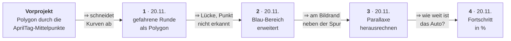
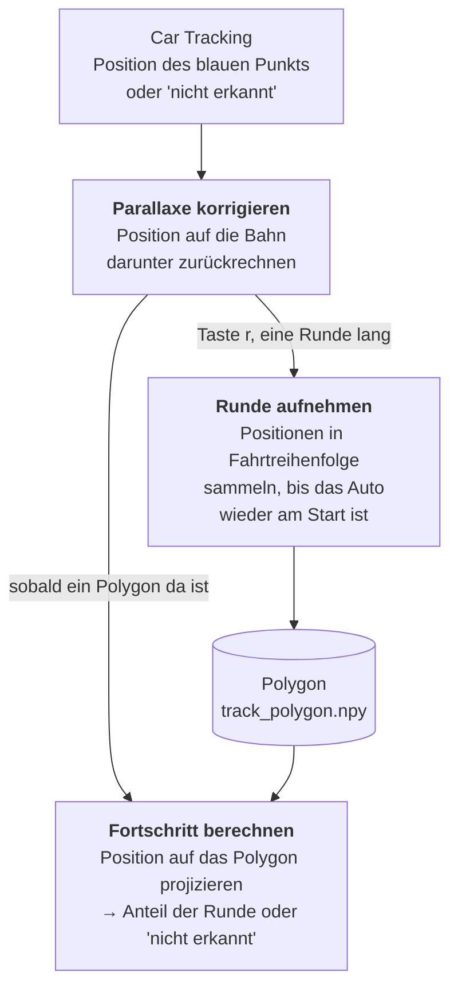
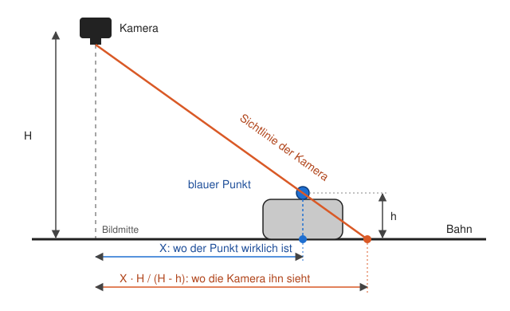
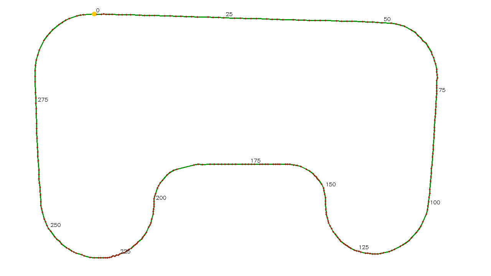
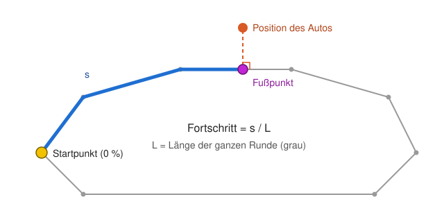

# Car to Track: Wie wir die Strecke aus der Fahrt des Autos gewinnen

> Draft, Stand 20.11.2026. Beschreibt `car_to_track.py` auf dem Branch `car_to_track`.
> Die Bedienung steht im Docstring der Datei, hier geht es um das Warum. Die Position des Autos kommt
> aus dem Car Tracking, siehe [dessen Doku](../car_diff_tracking/DOKU.md).

Das Experiment liefert zwei Dinge: ein Polygon der Strecke, also die Pixelpunkte der Spur in
Fahrtrichtung, und für jedes Kamerabild den Fortschritt des Autos als Anteil einer Runde oder
ausdrücklich „nicht erkannt“. Für das Polygon reicht eine langsam gefahrene Runde. Das Auto fährt die
Strecke ab, seine Positionen sind also schon die Strecke.

## Der Weg zur Lösung



Das Vorprojekt hat den Fortschritt auf einem Polygon durch die Mittelpunkte der AprilTags berechnet.
Die Verbindungslinien zwischen den Tags schneiden jede Kurve ab, mit der gefahrenen Linie hatte das
Polygon wenig zu tun.

1. Wir nehmen eine Runde lang die Positionen des blauen Punkts auf. Weil das Auto der Spur folgt, liegen
   sie schon in Fahrtrichtung vor und bilden direkt das Polygon. ⇒ An einer Stelle fehlten mehrere
   Punkte, und das Polygon überbrückte die Lücke mit einer geraden Kante.
2. Der Farbton des Punkts lag dort genau auf der Obergrenze des Blau-Bereichs. Wir haben den Bereich im
   Car Tracking erweitert, die Werte stehen in dessen Doku. ⇒ Zum Bildrand hin lag das Polygon
   sichtbar außen neben der Spur, und zwar umso mehr, je weiter vom Bildmittelpunkt entfernt.
3. Die Ursache ist die Parallaxe, der Punkt liegt höher als die Bahn. Jede Position wird jetzt auf die
   Stelle der Bahn direkt darunter zurückgerechnet. ⇒ Das Polygon allein sagt noch nicht, wie weit das
   Auto auf der Runde ist.
4. Die aktuelle Position wird auf das Polygon projiziert. Daraus ergibt sich der Fortschritt in Prozent.

---

## So funktioniert es




*Grün: Polygon. Gelb: Startpunkt. Magenta: Position des Autos auf dem Polygon. Oben links der
Fortschritt.*

### Parallaxe korrigieren

Der blaue Punkt klebt 2 cm über der Bahn auf dem Auto. Die Kamera sieht ihn entlang einer schrägen
Sichtlinie, und diese Linie trifft die Bahn erst ein Stück weiter außen. Im Bild erscheint der Punkt
deshalb dort, wo diese äußere Stelle der Bahn liegt. Direkt unter der Kamera, also in der Bildmitte,
fällt das nicht auf. Zum Rand hin wächst der Versatz, und er zeigt immer von der Bildmitte weg.


*Seitenansicht, nicht maßstabsgetreu. Die Höhe h ist stark übertrieben.*

Wie groß der Versatz ist, folgt aus dem Strahlensatz. Die Sichtlinie geht von der Kamera in Höhe H durch
den Punkt in Höhe h. Bis zum Punkt sinkt sie um H - h und kommt dabei waagrecht X weit. Bis zur Bahn
muss sie um H sinken und kommt dabei X · H / (H - h) weit. Der Punkt erscheint also um den Faktor
H / (H - h) zu weit von der Bildmitte entfernt.

Weil die Kamera senkrecht nach unten schaut, ist der Abstand zur Bildmitte im Bild proportional zum
Abstand auf der Bahn. Zum Korrigieren wird jede Position um den umgekehrten Faktor zur Bildmitte
gezogen:

```
korrigiert = Bildmitte + (gemessen - Bildmitte) · (H - h) / H
```

Bei unserem Aufbau ist der Faktor 106 / 108 ≈ 0,98. Das klingt nach wenig, am Bildrand sind es aber bis
zu 12 px.

Für den Fortschritt allein wäre die Korrektur nicht nötig, denn die Live-Position hat denselben Versatz
wie das Polygon. Sobald wir das Polygon mit der echten Strecke vergleichen, etwa mit den AprilTags oder
den Teilemaßen in Millimetern, zählt aber jeder systematische Fehler.

Die Rechnung nimmt an, dass die Kamera genau senkrecht nach unten schaut und die Bildmitte die Stelle
direkt unter ihr ist. Liegt das korrigierte Polygon auf einer Seite der Strecke noch daneben, hängt die
Kamera leicht schräg.

| Äußere Kurve am Bildrand | Innere Kurve nahe der Bildmitte |
|---|---|
|  |  |

*Polygon vor der Korrektur. Links liegt es außen neben der Spur, das ist die Parallaxe. Rechts schneidet
es die Kurve nach innen. Das hat eine andere Ursache, siehe Grenzen.*

### Runde aufnehmen

Die Positionen kommen in der Reihenfolge, in der das Auto die Strecke abfährt. Eine Runde lang
gesammelt, sind sie schon das fertige Polygon. Sortieren muss man nichts. Ein nachträgliches Sortieren,
etwa indem man immer den nächstgelegenen Punkt anhängt, würde an einer Kreuzung scheitern: Dort liegen
zwei Teile der Strecke übereinander, und das Verfahren könnte falsch abbiegen.

Ein neuer Punkt kommt erst dazu, wenn er mindestens 5 px vom letzten entfernt ist. Steht das Auto,
entsteht so kein Punkthaufen, und langsame Stellen bekommen nicht mehr Punkte als schnelle. Bilder, in
denen der Punkt nicht erkannt wird, fallen weg. Das Polygon verbindet die Nachbarn dann mit einer
geraden Linie. So ist in der ersten Runde die Kante bei Punkt 188 entstanden.

Die Runde ist geschlossen, sobald das Auto wieder weniger als 30 px vom Startpunkt entfernt ist.
Außerdem müssen mindestens 100 Punkte da sein. Sonst wäre die Runde gleich nach dem Start schon
geschlossen, weil das Auto dann noch neben dem Startpunkt fährt.

Gespeichert wird ein NumPy-Array mit N Zeilen und 2 Spalten. Zeile i ist der i-te Punkt in
Fahrtrichtung, die Spalten sind x und y in Pixeln. Beim nächsten Start wird die Datei automatisch
geladen. Die Pixel gelten nur für genau diesen Kameraaufbau, deshalb ist die Datei nicht im Git.

Die Runde sollte langsam und gleichmäßig gefahren werden. Bei voller Fahrt verschmiert der Punkt
leichter, und das Heck schwenkt in den Kurven aus. Beides macht das Polygon ungenauer.

| Reihenfolge der Punkte | Polygon im Kamerabild |
|---|---|
|  |  |

*Links die erste Runde mit Punktnummern. Die gerade Kante bei 188 ist ein Aussetzer. Rechts eine
spätere Runde, noch ohne Parallaxe-Korrektur.*

### Fortschritt berechnen

Die Idee stammt aus dem Wiki ([Überarbeitung Streckenerkennung](https://app.notion.com/p/417946076ebb8085a4f0c081f6cc3afa)):
Die Position des Autos ist der Anteil der Runde, den es seit dem Startpunkt zurückgelegt hat.

Die Live-Position liegt fast nie genau auf dem Polygon. Ein kleiner seitlicher Abstand bleibt immer,
schon weil keine Runde genau wie die andere gefahren wird. Deshalb wird die Position auf das Polygon
projiziert:



Für jeden Abschnitt zwischen zwei benachbarten Polygonpunkten wird das Lot von der Position auf den
Abschnitt gefällt. Der Fußpunkt ist die Stelle, an der die Verbindung senkrecht auf den Abschnitt
trifft. Läge er außerhalb des Abschnitts, wird er auf dessen Anfang oder Ende gesetzt. Von allen
Abschnitten gewinnt der mit dem kürzesten Abstand. Der Weg s vom Startpunkt bis zum Fußpunkt ist die
Länge aller Abschnitte davor plus der Anteil des aktuellen. Geteilt durch die Länge L der ganzen Runde
ergibt das den Fortschritt.

Ein seitlicher Abstand verändert den Fortschritt dadurch nicht. Nur an den Ecken des Polygons ist die
Verbindung zum Eckpunkt nicht ganz senkrecht. Die Punkte liegen aber nur etwa 10 px auseinander, die
Knicke sind also flach und der Fehler vernachlässigbar.

Die Live-Position wird vorher genauso um die Parallaxe korrigiert wie die Punkte des Polygons. Ein
Polygon, das ohne Korrektur aufgenommen wurde, passt deshalb nicht mehr dazu und muss neu aufgenommen
werden.

Wird der Punkt nicht erkannt, ist der Fortschritt „nicht erkannt“ und nicht der letzte bekannte Wert.

### Stellschrauben

| Parameter | Standard | Wirkung |
|---|---|---|
| Mindestabstand (`MIN_STEP`) | 5 px | ab welchem Abstand zum letzten Punkt eine Position als neuer Punkt dazukommt |
| Schließabstand (`CLOSE_DIST`) | 30 px | so nah am Startpunkt gilt die Runde als geschlossen |
| Mindestanzahl Punkte (`MIN_POINTS`) | 100 | verhindert, dass die Runde gleich nach dem Start schließt |
| Kamerahöhe (`CAMERA_HEIGHT`) | 108 cm | von der Bahn bis zur Kamera. Bei neuem Aufbau neu messen |
| Höhe des Punkts (`DOT_HEIGHT`) | 2 cm | von der Bahn bis zum blauen Punkt |


## Grenzen und offene Punkte

- In Kurven schneidet das Polygon nach innen (Bild oben, rechts). Der Punkt klebt hinter dem Leitkiel.
  Der Kiel läuft in der Spur, der Rest des Autos fährt wie der Anhänger eines LKW einen engeren Bogen.
  Abhilfe wäre, den Punkt möglichst weit vorne mittig über den Kiel zu kleben. Das ist noch offen.
- Das Polygon ist die Mittellinie der Spur, auf der das Auto fährt, nicht die Mitte der Strecke. Für
  die zweite Spur braucht es eine eigene Runde.
- Alles ist in Pixeln. Wird die Kamera bewegt, muss die Runde neu aufgenommen werden.
- An einer Kreuzung ist der nächstgelegene Abschnitt nicht eindeutig, der Fortschritt kann dort
  springen. Unsere aktuelle Strecke hat keine Kreuzung.
- Der Vergleich mit der echten Geometrie (AprilTags, Teilemaße in Millimetern) fehlt noch. Dabei kann es
  nötig werden, die Verzerrung des Weitwinkelobjektivs herauszurechnen, zum Beispiel mit einer
  Kamerakalibrierung über ein Schachbrettmuster.
- Die Geschwindigkeit entlang der Strecke fehlt bewusst. Sinnvoll wird sie erst mit den Teilemaßen in
  Millimetern aus der Streckenerkennung.
